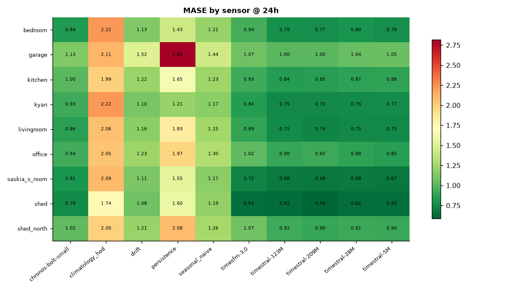
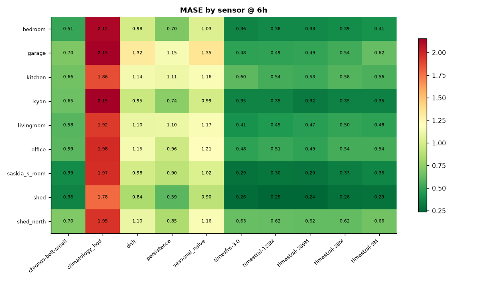
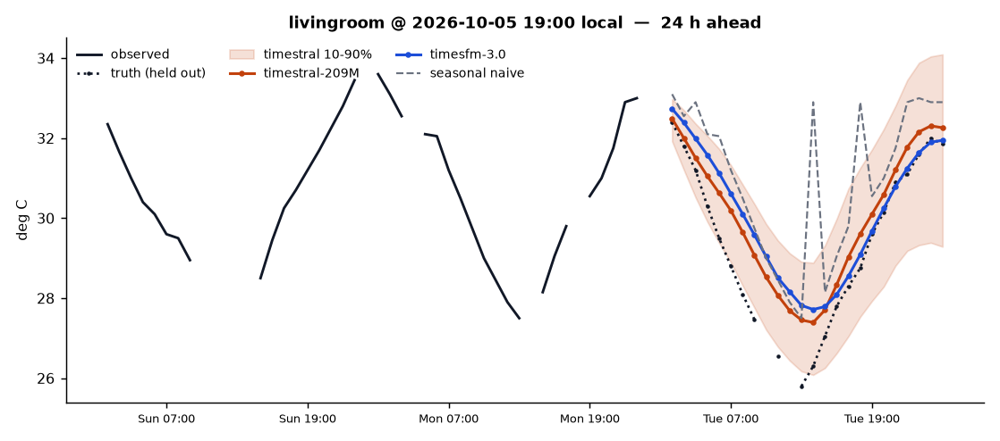
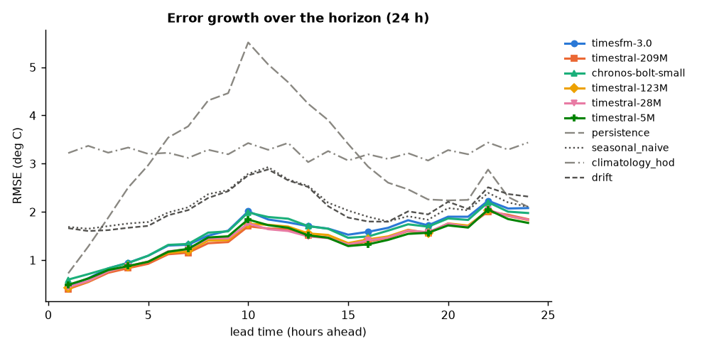
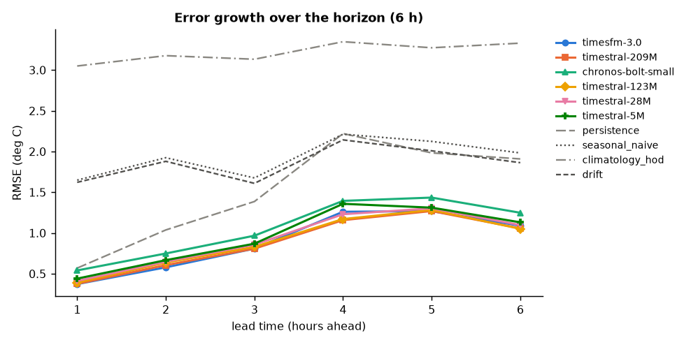
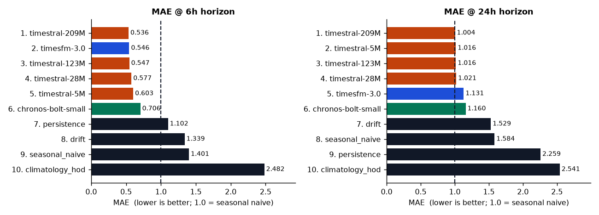
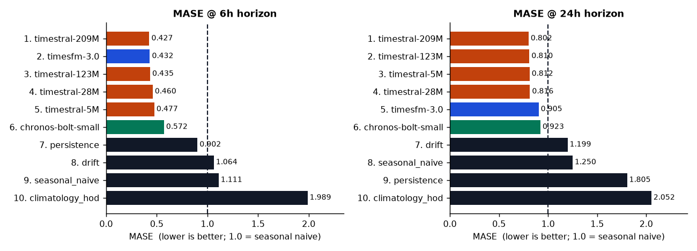

# sensorcast — zero-shot temperature forecasting on the family's Shelly sensors

Benchmark of Mistral **Timestral** (5M/28M/123M/209M) against Google **TimesFM 3.0**, Amazon **Chronos-Bolt**, and four training-free baselines, on **hourly temperature from 9 Shelly H&T sensors** in the house and the shed.

## Key findings

- **6 h ahead** — **Timestral-209M** is best on aggregate MASE **0.427** (MAE 0.54 °C), 2.6× better than seasonal naive (1.111).
- **24 h ahead** — **Timestral-209M** is best on aggregate MASE **0.802** (MAE 1.00 °C), 1.6× better than seasonal naive (1.250).
- **Model size pays at 6 h** — 5M → 209M buys **10.5%** MASE (0.477 → 0.427) for **36× the CPU** (5 → 180 ms/series).
- **Model size barely pays at 24 h** — 5M → 209M buys **1.3%** MASE (0.812 → 0.802) for **36× the CPU** (5 → 181 ms/series).
- **Exogenous weather beats the model-size upgrade** — timestral-209M at 24 h: MASE **0.802 → 0.524** (**35% lower**) when handed the actual outdoor temperature across the horizon (oracle — see the covariate arm).
- **Exogenous weather beats the model-size upgrade** — timestral-209M at 6 h: MASE **0.427 → 0.349** (**18% lower**) when handed the actual outdoor temperature across the horizon (oracle — see the covariate arm).
- **6 h, sensor by sensor** — wins: TimesFM 3.0 (200M) 5/9, Timestral-209M 4/9.
- **Interval calibration at 6 h** (nominal 80%) — Timestral-209M 83%, TimesFM 3.0 (200M) 70%, Chronos-Bolt-small 86%. Timestral's bands are close to nominal; TimesFM's are too narrow, so it looks sharper than it is on WQL while under-covering.
- **24 h, sensor by sensor** — wins: Timestral-209M 5/9, Timestral-123M 2/9, Timestral-5M 2/9.
- **Interval calibration at 24 h** (nominal 80%) — Timestral-209M 80%, TimesFM 3.0 (200M) 72%, Chronos-Bolt-small 80%. Timestral's bands are close to nominal; TimesFM's are too narrow, so it looks sharper than it is on WQL while under-covering.

## Dataset

- Source: live `shelly.db` archive, hourly mean of 13,858 samples (54 days: 2026-08-26 20:00:00-07:00 → 2026-10-19 18:00:00-07:00 local).
- Grid: `1h`, 1295 hours × 9 sensors, **32% of cells empty** (kept as NaN, not interpolated).
- Per-sensor hourly coverage: shed_north 83%, garage 79%, saskia_s_room 71%, shed 71%, office 69%, bedroom 65%, kitchen 63%, livingroom 61%, kyan 52%.

## Protocol

- Rolling origins every **12 h** over the final **14 days**; context **504 h (3 weeks)**; horizons 24, 6 h.
- Every model is **zero-shot** — no fitting, no fine-tuning on this data.
- A window is scored only where the ground truth exists; sensors that drop out mid-horizon are scored on the hours they reported.
- `MASE` = MAE ÷ the window's own seasonal-naive error scale (mean |yₜ − yₜ₋₂₄ₕ| over the context). **MASE < 1 beats "same hour yesterday"**; MASE is the primary ranking because it normalises for how volatile each sensor is.
- `WQL` = GIFT-Eval-style weighted quantile loss (10–90% deciles, scale-free). Only the three foundation models emit quantiles, so baselines have no WQL.

## Results

### 6-hour horizon

| model | mae | rmse | mase | wql | coverage80 | width80 | ms_per_series |
| --- | --- | --- | --- | --- | --- | --- | --- |
| Timestral-209M | 0.536 | 0.612 | 0.427 | 0.016 | 0.831 | 1.868 | 180 |
| TimesFM 3.0 (200M) | 0.546 | 0.626 | 0.432 | 0.017 | 0.697 | 1.510 | 197 |
| Timestral-123M | 0.547 | 0.623 | 0.435 | 0.017 | 0.830 | 1.850 | 104 |
| Timestral-28M | 0.577 | 0.656 | 0.460 | 0.018 | 0.828 | 1.942 | 37 |
| Timestral-5M | 0.603 | 0.683 | 0.477 | 0.018 | 0.829 | 1.959 | 5 |
| Chronos-Bolt-small | 0.706 | 0.784 | 0.572 | 0.021 | 0.861 | 2.685 | 21 |
| persistence | 1.102 | 1.234 | 0.902 |  |  |  | 0 |
| drift | 1.339 | 1.458 | 1.064 |  |  |  | 0 |
| seasonal naive | 1.401 | 1.520 | 1.111 |  |  |  | 0 |
| climatology (hour-of-day) | 2.482 | 2.566 | 1.989 |  |  |  | 0 |

*n = 236 windows, 9 sensors.*

### 24-hour horizon

| model | mae | rmse | mase | wql | coverage80 | width80 | ms_per_series |
| --- | --- | --- | --- | --- | --- | --- | --- |
| Timestral-209M | 1.004 | 1.195 | 0.802 | 0.031 | 0.796 | 3.305 | 181 |
| Timestral-123M | 1.016 | 1.205 | 0.810 | 0.031 | 0.793 | 3.349 | 97 |
| Timestral-5M | 1.016 | 1.209 | 0.812 | 0.032 | 0.787 | 3.333 | 5 |
| Timestral-28M | 1.021 | 1.212 | 0.816 | 0.032 | 0.786 | 3.323 | 52 |
| TimesFM 3.0 (200M) | 1.131 | 1.333 | 0.905 | 0.035 | 0.723 | 3.383 | 196 |
| Chronos-Bolt-small | 1.160 | 1.348 | 0.923 | 0.035 | 0.800 | 3.661 | 18 |
| drift | 1.529 | 1.836 | 1.199 |  |  |  | 0 |
| seasonal naive | 1.584 | 1.865 | 1.250 |  |  |  | 0 |
| persistence | 2.259 | 2.619 | 1.805 |  |  |  | 0 |
| climatology (hour-of-day) | 2.541 | 2.746 | 2.052 |  |  |  | 0 |

*n = 230 windows, 9 sensors.*

### Per-sensor MASE (primary horizon)

| sensor | chronos-bolt-small | seasonal_naive | timesfm-3.0 | timestral-123M | timestral-209M | timestral-28M | timestral-5M | best |
| --- | --- | --- | --- | --- | --- | --- | --- | --- |
| bedroom | 0.837 | 1.215 | 0.940 | 0.787 | 0.774 | 0.801 | 0.777 | timestral-209M |
| garage | 1.134 | 1.439 | 1.075 | 1.004 | 1.004 | 1.042 | 1.053 | timestral-123M |
| kitchen | 1.001 | 1.229 | 0.926 | 0.842 | 0.855 | 0.869 | 0.880 | timestral-123M |
| kyan | 0.926 | 1.172 | 0.843 | 0.752 | 0.746 | 0.761 | 0.767 | timestral-209M |
| livingroom | 0.862 | 1.249 | 0.891 | 0.755 | 0.735 | 0.753 | 0.750 | timestral-209M |
| office | 0.937 | 1.305 | 1.019 | 0.897 | 0.915 | 0.876 | 0.853 | timestral-5M |
| saskia_s_room | 0.807 | 1.171 | 0.722 | 0.684 | 0.675 | 0.678 | 0.669 | timestral-5M |
| shed | 0.758 | 1.191 | 0.630 | 0.623 | 0.589 | 0.624 | 0.631 | timestral-209M |
| shed_north | 1.023 | 1.264 | 1.074 | 0.921 | 0.897 | 0.912 | 0.904 | timestral-209M |

*24 h horizon. `seasonal_naive` is the reference line every foundation model has to clear.*

## Covariate arm — does tomorrow's outdoor temperature help?

Timestral accepts a *known-future* covariate. We fed it the real outdoor sensor (`shed_north`, sun-exposed, best uptime) across the horizon. That is an **oracle** — a real deployment would need a weather forecast — so read it as an upper bound on what exogenous weather information could buy, not as an achievable score.

| horizon | model | mae | mase |
| --- | --- | --- | --- |
| 6 | timestral-209M+oracle-weather | 0.393 | 0.349 |
| 6 | timestral-28M+oracle-weather | 0.427 | 0.381 |
| 24 | timestral-209M+oracle-weather | 0.603 | 0.524 |
| 24 | timestral-28M+oracle-weather | 0.621 | 0.542 |

## Latency (this box: Intel N150, 4 cores, CPU-only)

| model | 6h | 24h |
| --- | --- | --- |
| chronos-bolt-small | 21 | 18 |
| timesfm-3.0 | 197 | 196 |
| timestral-123M | 104 | 97 |
| timestral-209M | 180 | 181 |
| timestral-28M | 37 | 52 |
| timestral-5M | 5 | 5 |

*Milliseconds per series per forecast, batched (48 series per forward pass), 4 torch threads. No GPU was used.*

## Figures

## What this means for us

- At **6 h**, run **Timestral-28M**: MASE 0.460 versus 0.427 for 209M (7.9% worse) at a fraction of the CPU cost — the right default for a household forecast (`scripts/forecast_now.py` uses it).
- At **24 h**, run **Timestral-28M**: MASE 0.816 versus 0.802 for 209M (1.7% worse) at a fraction of the CPU cost — the right default for a household forecast (`scripts/forecast_now.py` uses it).
- **The next real gain is not a bigger model, it is a weather input.** Handing the model the actual outdoor temperature (even as an oracle) cut MASE far more than any size step. Wiring a real forecast feed into the covariate slot is the highest-value follow-up.

## Honest caveats

- **54 days is short.** Diurnal cycles are well represented; seasonal drift is not. These numbers say nothing about a winter/summer transition.
- **The sensors are not independent.** Indoor rooms share HVAC and outdoor weather; windows overlap in time, so the effective sample size is smaller than the window count.
- **Timestral's leaderboard wins are self-reported by Mistral** and, at launch, had not cleared external review. This benchmark is independent of that claim but is also *our* data only — 9 series, one house, one season.
- **Nothing here is tuned.** No context-length sweep, no per-sensor scaling, no ensembling. A tuned Timestral would score better than these numbers; so might the others.
- MASE is computed against an in-context scale, so a window whose context is unusually calm shows a harsher MASE. Read MAE/RMSE alongside it.
